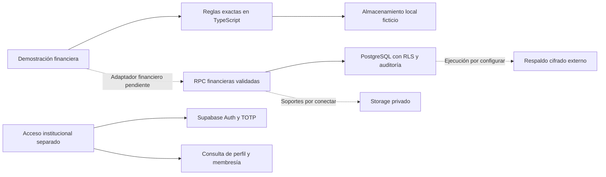

# Arquitectura de Trefil OS

Trefil OS separa la presentación, las reglas financieras y la autorización persistente. La primera entrega incluye una aplicación de demostración y un backend PostgreSQL preparado; falta conectarlos con un adaptador y verificar el recorrido completo. Una sesión en `/acceso/` no habilita por sí sola operaciones financieras.

## Componentes actuales y conexión pendiente

| Capa | Responsabilidad y límite |
| --- | --- |
| `src/app` | Rutas Next.js App Router, metadatos y exportación estática. La compilación genera `out/`. |
| `src/components` | Tablero y flujos accesibles de finanzas. Filtra por sede y presenta pendientes, realizados y proyecciones por separado. |
| `src/lib/finance` | Tipos, centavos exactos, reglas, amortización, alertas y escenario ficticio. Los controles del navegador sirven para revisión, no para autorizar dinero real. |
| `src/lib/supabase` | Cliente restringido al proyecto institucional, Auth, MFA y comprobaciones de identidad/membresía. No contiene un adaptador del libro. |
| `supabase/migrations` | Contratos persistentes, RLS, doble entrada, inmutabilidad y acceso a soportes. Las migraciones no importan datos reales ni crean contraseñas. |
| `supabase/operations` | Aprovisionamiento manual del propietario, credencial de registro de respaldos y consultas de verificación. Su ejecución exige un operador y un destino comprobados. |
| `scripts/backup` | Captura lógica, documentos privados, cifrado, checksums, recibo, restauración aislada y copia a un volumen seleccionado. |
| `.github/workflows` | CI sin secretos ni despliegues; respaldo diario separado y condicionado a activación explícita. |

La persistencia de demostración usa una clave distinta de la sesión institucional. Valida cada instantánea antes de cargarla o guardarla y mantiene un bloqueo Web Locks para una sola pestaña escritora. Sin bloqueo o ante una copia dañada falla a lectura y conserva la copia original; esto no proporciona coordinación entre dispositivos. Los datos del escenario no deben copiarse automáticamente a Supabase al iniciar sesión. El adaptador pendiente deberá exigir identidad activa y AAL2, transportar dinero como texto decimal y resolver el mapeo de entidades y estados de forma explícita. No debe leer valores `numeric` de gran magnitud mediante conversiones a `Number` que pierdan centavos.

## Invariantes financieros

Cada registro pertenece a una empresa y sede. Cuentas, responsables, soportes, estados, origen e idempotencia forman parte de la trazabilidad. El modelo detallado y las RPC están en [Modelo de datos](data-model.md).

Un movimiento solo afecta saldos cuando está contabilizado. Un traslado tiene dos partidas compensadas; un ingreso, gasto, apertura o pago usa su contrapartida contable. `loan` significa préstamo recibido y acredita un pasivo; un anticipo entregado usa un activo por legalizar. Las correcciones conservan el original y generan un reverso con partidas opuestas, aprobado por otra persona. No hay un campo de saldo editable ni una API para borrar movimientos.

La política inicial exige revisión independiente a partir de COP 5.000.000 y para aperturas, ajustes, gastos personales, pagos de deuda y reversos de cualquier monto. Propiedad y administración pueden decidir; el solicitante nunca decide su propia operación. El capital reservado por pagos pendientes impide solicitar abonos que excedan el saldo. Los pagos rechazados o reversados no cuentan como capital pagado.

El simulador calcula cuotas mensuales y redondea por período con aritmética exacta. Permite gracia a capital, tasas acordadas por cuota y abonos extraordinarios proyectados. No calcula devengos diarios, impuestos, comisiones ni una liquidación certificada del acreedor. El plan original y las asignaciones de pagos reales se presentan separados. Las alertas no se resuelven mediante una declaración mientras la causa comprobable siga activa; los posibles duplicados admiten una resolución documentada como falso positivo.

El tablero distingue resultado operativo de movimiento de efectivo. La apertura aporta la posición inicial, sin generar un ingreso comercial ni una tendencia ficticia. El flujo incluye financiación y capital efectivamente movidos; la línea futura continúa desde el saldo o flujo real al corte y resta cuotas futuras pendientes. No estima nuevos ingresos ni asigna una nueva fecha de pago a cuotas ya vencidas.

## Identidad, permisos y soportes

El aislamiento persistente se aplica en PostgreSQL a partir del usuario autenticado, perfil activo, membresía y sede. Los roles del navegador y `user_metadata` no son una autoridad. Las escrituras pasan por RPC; la pertenencia empresarial se vuelve a comprobar en la base. Un auditor consulta sin poder registrar movimientos o tomar decisiones. [Seguridad](security.md) describe los privilegios de las funciones internas, las restricciones y las pruebas.

El correo institucional identifica al propietario inicial para el aprovisionamiento revisado. Los operadores cotidianos deben usar usuarios personales. El acceso de Microsoft y el TOTP de Supabase son controles separados. Ni la recuperación de contraseña ni la posesión de una clave publicable conceden una membresía financiera.

Los documentos permanecen en un bucket privado con rutas por empresa, sede y soporte; su metadato y checksum se registran después de comprobar el objeto. La carga, descarga autenticada, tipo real del archivo y rechazo de objetos ajenos requieren pruebas HTTP en el proyecto institucional. No se amplía el acceso a otros negocios para solucionar un permiso.

La aplicación estática conserva la sesión de Supabase con el SDK en el navegador, no en cookies HttpOnly. Antes del uso empresarial deben evaluarse este diseño, dispositivos autorizados, protección frente a XSS y una posible evolución a sesión de servidor. La CSP actual limita orígenes pero mantiene scripts y estilos inline; no sustituye RLS, MFA ni protección de despliegue.

## Límites modulares futuros

| Área | Límite de integración previsto |
| --- | --- |
| Identidad, auditoría y continuidad | Servicios transversales de permisos, evidencias, respaldos y recuperación. |
| Tesorería y financiación | Libro, cuentas, conciliaciones, acreedores y obligaciones de la primera fase. |
| Comercial | Clientes, proveedores, cotizaciones, pedidos, remisiones, ventas y cartera. Emite solicitudes contables autorizadas. |
| Operación industrial | Inventarios, producción, materiales, desperdicios, activos y mantenimiento. Conserva sus propios movimientos y aprobaciones. |
| Personas y ejecución | Personal, asistencia, productividad, proyectos y tareas, con acceso por responsabilidad. |
| Documentos, alertas y reportes | Soportes privados, evidencias y lecturas autorizadas por ámbito. |
| Integraciones e IA | Eventos entrantes idempotentes, conexiones acotadas y recomendaciones registradas. No alteran dinero, nómina, precios o inventario sin aprobación humana. |

Estos límites están previstos en el diseño; no constituyen módulos completos ni páginas habilitadas de una primera entrega. Las integraciones con Drive y Microsoft requieren autorización específica y un ámbito de datos identificado.

## Secuencia de puesta en marcha

1. Conservar la confirmación del cambio de contraseña expuesta y doble factor; verificar el propietario institucional en el navegador. Localizar recursos antes de crearlos y mantener el repositorio privado.
2. Configurar el proyecto Vercel vacío antes de vincular Git: destino autorizado, rama de producción, condición de omisión y protección del preview. Comprobar que `main` no produce un despliegue y que la rama autorizada produce solo preview. El primer import puede saltarse la condición de omisión; no usarlo como prueba del bloqueo.
3. Revisar y aplicar migraciones en el entorno institucional vacío o en uno aislado autorizado. Ejecutar las consultas de verificación y Advisors. Los fixtures locales de Auth y Storage de PGlite no equivalen al servicio hospedado.
4. Configurar Auth, redirecciones exactas y política de usuarios; aprovisionar al propietario y usuarios personales. Probar inicio, cierre, recuperación, MFA, usuario inactivo y revocación de membresía. Repetir intentos directos al Data API con AAL1, otro rol y otra sede.
5. Conectar el adaptador financiero y Storage privado. Ejecutar con datos ficticios ingreso, gasto, traslado y reverso, repetición idempotente, aprobación de personas distintas, pago con reparto y conciliación con diferencia. Verificar respuesta, asientos, saldo y auditoría en cada operación.
6. Ejecutar un respaldo manual cifrado con documentos y registro; verificar checksum. Restaurar en una base vacía aislada y comprobar permisos, soportes y saldos. Seleccionar con el usuario el disco externo, copiar únicamente el respaldo cifrado y verificar el destino.
7. Activar y observar una ejecución diaria, fallos controlados y la alerta por más de 24 horas sin copia verificada. Medir el tiempo de recuperación y acordar retención y responsables de continuidad.
8. Revisar las evidencias del sistema conectado antes de importar datos reales y autorizar una primera producción. Las pruebas locales y una página accesible no satisfacen esos criterios por sí solas.

## Control de despliegues

El CI solo instala dependencias bloqueadas, comprueba tipos, ejecuta pruebas y construye. Usa commits completos de las releases oficiales de `actions/checkout` y `actions/setup-node`, con permisos de lectura y sin persistir credenciales. No recibe secretos institucionales ni hace migraciones o promociones.

La configuración Git desactiva `main`; las demás ramas no especificadas conservan el comportamiento predeterminado de Vercel. La condición de build permite únicamente `VERCEL_ENV=preview`, omitiendo producción y entornos desconocidos. Un administrador puede eludir estos controles mediante acciones manuales o una salida precompilada; el acceso del proveedor y la prohibición de producción siguen siendo necesarios. La protección de visitantes de preview se configura y prueba en el panel, no con una cabecera `noindex`. [Configuración Git oficial](https://vercel.com/docs/project-configuration/git-configuration), [condición de omisión](https://vercel.com/docs/project-configuration/vercel-json#ignorecommand).

El estado de los recursos y las verificaciones de cada despliegue se registra en [Estado de implementación](implementation-status.md), con el commit, entorno, URL y resultados observados. Las credenciales, códigos TOTP, QR privados, respaldos y datos empresariales reales no forman parte de esa evidencia versionada.
